# Adam

Adam is an autonomous software engineering and security investigation agent being
designed as an Agent Service Provider (ASP) for OKX.AI.

Adam inspects software systems, correlates technical evidence, and returns
prioritized, actionable conclusions. It is not a chatbot, an IDE autocomplete
tool, a generic code generator, or a hackathon judging agent.

## Project status

**Sprint 8: Multi-Language Intelligence**

Sprints 1 through 7 are approved. The repository now contains:

- a Node.js and TypeScript pnpm workspace;
- a modular Express API;
- a free A2MCP-compatible HTTP service boundary;
- a request planner with repository-intelligence prerequisites;
- bounded public GitHub repository acquisition through Git;
- a reusable internal Repository Model;
- deterministic language, framework, package-manager, Docker, CI/CD, Solidity,
  environment-file, and configuration-file detection;
- independent secrets, dependency, authentication/authorization,
  configuration, static-pattern, and Solidity inspectors;
- deterministic structured security findings with severity, evidence,
  file/line, and confidence;
- rule-aware explanations, impact analysis, likelihood, remediation, and
  evidence references for every finding;
- deterministic versioned security scoring by category;
- overall risk ratings and recommended fix ordering;
- a professional structured Security Report;
- a deterministic Root Cause Investigation pipeline for repository and log
  correlation;
- independent, extensible root-cause detector categories with ranked
  evidence-backed candidates;
- structured impact, fix, prevention, related-file, related-dependency, and
  supporting-log output;
- deterministic natural-language intent classification;
- dependency-resolved execution plans and a registry-based service
  orchestrator;
- one shared Repository Model across multi-service requests;
- unified repository, security, root-cause, risk, recommendation, and execution
  metadata responses;
- complete finding-to-evidence traceability for canonical recommendations;
- deterministic analysis by default and optional evidence-constrained AI
  intelligence with strict finding-ID validation and bounded caching;
- public GitHub pull request acquisition through the official GitHub API;
- incremental changed-file-only repository modeling and deterministic security
  review;
- pull request intent routing and unified Planner responses without a full
  repository clone;
- first-class Rust, Go, Python, Java, Kotlin, Swift, C, C++, C#, and PHP
  repository detection with confidence and evidence;
- deterministic language-specific security and reliability rules integrated
  into the existing static-pattern inspector;
- opt-in live dependency advisory enrichment through OSV with time-stamped
  results;
- opt-in Docker-isolated Node.js build and test validation with fail-closed
  host execution controls;
- structured logging and persistent operational runtime state;
- Docker, Railway, and GitHub Actions configuration.

Conversational chat, new services, and new A2MCP integrations remain
intentionally unimplemented.

Last documentation review: **July 29, 2026**

## Initial services

### Security Audit

Given a public GitHub repository, Adam:

- map the repository and detect its technology stack;
- inspect dependencies, configuration, secrets exposure, authentication, and
  authorization;
- inspect smart contracts when present;
- detect deterministic static security patterns;
- explain every finding using its recorded evidence;
- calculate transparent category and overall security scores;
- return severity-grouped findings, a recommended fix order, and a structured
  professional report.

The default `static` security profile remains deterministic and offline.
`live` adds exact-version OSV advisory checks, while `sandboxed` also runs
supported Node.js build and test scripts in a constrained Docker environment.
Sandbox results strengthen evidence but do not claim proven reachability or
exploitability.

### Root Cause Investigation

Given a public GitHub repository and deployment, runtime, CI, stack-trace, or
error logs, Adam:

- understand the relevant repository structure;
- normalize and correlate failures across code, configuration, and logs;
- identify the most probable root cause;
- state confidence and supporting evidence;
- recommend a fix and prevention measures.

Sprint 5 uses deterministic signatures and repository correlation. It does not
execute the repository, reproduce the failing system, or invent causes without
supporting evidence.

### Planner & Service Orchestration

Given a natural-language request, repository URL, and optional logs, Adam:

- classifies repository, security, root-cause, or combined intent;
- generates a dependency-ordered execution plan;
- clones and scans the repository once;
- executes approved services against one shared Repository Model;
- aggregates service outputs without changing their findings or scores;
- returns one deterministic unified response with an execution timeline.

Broad combined requests without logs run Repository Intelligence and Security
Audit while documenting why Root Cause Investigation was omitted. Explicit
failure investigations require logs and fail validation rather than guessing.

### Evidence Traceability & AI Intelligence

Every canonical recommendation includes its recommendation ID, related finding
IDs, evidence IDs, repository file, line numbers, rule ID, confidence, and
source service. All analysis endpoints accept `analysisMode`; it defaults to
`deterministic`. `intelligent` mode can only explain and prioritize findings
already produced by the deterministic engines.

### GitHub Pull Request Review

Given a public GitHub pull request, Adam:

- retrieves metadata, changed-file statistics, patches, and available head
  file content;
- builds an ephemeral Repository Model containing only modified files;
- reuses the existing deterministic Security Audit, scoring, evidence, and
  traceability pipeline;
- optionally applies the existing evidence-constrained AI layer;
- falls back to a successful deterministic response with `aiReview: null` when
  AI is disabled or unavailable;
- lets the Planner route pull request review requests without cloning the full
  repository.

### Multi-Language Intelligence

Repository Intelligence detects JavaScript/TypeScript and Solidity as before,
plus first-class Rust, Go, Python, Java, Kotlin, Swift, C, C++, C#, and PHP.
Each detected language includes source-file counts, percentage, confidence, and
manifest or source evidence. Mixed-language repositories retain every detected
language.

The existing deterministic static-pattern inspector consumes one canonical
language-rule registry. It detects bounded language-specific security and
reliability patterns without executing repository code. Live advisory lookup
and sandboxed runtime validation are separate, explicitly requested security
profiles.

## Product principles

- **Simple input:** users request an outcome, not a collection of analysis
  modules.
- **Evidence first:** every conclusion must be traceable to repository or log
  evidence.
- **Safe by default:** untrusted repositories are inspected without executing
  their code in the initial release.
- **Cloud first:** the production service must not depend on a developer
  computer remaining online.
- **Bounded services:** the initial A2MCP operations will have explicit,
  enforceable scope and input limits.
- **Professional engineering:** strong typing, structured logging, clear
  ownership, and production-grade error handling are required when
  implementation begins.

## Architecture at a glance

```mermaid
flowchart LR
    Client["OnchainOS / OKX.AI client"]
    API["Adam HTTP boundary"]
    Planner["Internal planner"]
    Classifier["Intent classifier"]
    Plan["Execution planner"]
    Workspace["Shared execution context"]
    RepositoryModel["Repository Model"]
    Services["Approved service registry"]
    Aggregate["Response aggregator"]

    Client -->|"A2MCP HTTP request"| API
    API --> Classifier
    Classifier --> Plan
    Plan --> Planner
    Planner --> Workspace
    Workspace --> RepositoryModel
    RepositoryModel --> Services
    Services --> Aggregate
    Aggregate --> API
    API -->|"structured result"| Client
```



Adam will run as an independently hosted HTTPS service. OKX.AI provides
identity, discovery, and service registration; Adam owns the investigation
runtime and its operational security.

See [ARCHITECTURE.md](ARCHITECTURE.md) for the complete proposed design and
[docs/OFFICIAL_SOURCES.md](docs/OFFICIAL_SOURCES.md) for the reviewed official
documentation and known ambiguities.

## Repository layout

```text
.
|-- .github/
|   `-- workflows/
|-- docs/
|   |-- OFFICIAL_SOURCES.md
|   |-- adr/
|   |-- operations/
|   `-- service-contracts/
|-- apps/
|   `-- api/
|       |-- src/
|       `-- test/
|-- packages/
|   `-- contracts/
|-- scripts/
|-- ARCHITECTURE.md
|-- CONTRIBUTING.md
|-- Dockerfile
|-- README.md
|-- package.json
|-- pnpm-workspace.yaml
|-- tsconfig.base.json
`-- railway.json
```

Directories are introduced only when they contain working code or active
documentation. External model adapters, chat modules, and new A2MCP adapters do
not exist.

## Run locally

Requirements:

- Node.js 22 or newer;
- Corepack;
- pnpm 11.15.1.

```powershell
corepack enable
pnpm install
Copy-Item .env.example .env
pnpm dev
```

The API listens on `http://localhost:4000` by default.

```text
GET  /
GET  /health
POST /repository/summary
POST /audit
POST /investigate
POST /review-pr
POST /plan
```

`POST /repository/summary` accepts:

```json
{
  "repositoryUrl": "https://github.com/onchaindc/Adam",
  "analysisMode": "deterministic"
}
```

It returns a structured repository summary. `POST /audit` accepts the same
request and returns enriched findings, scoring, fix order, and a structured
Security Report. It also accepts `securityProfile` as `static` (default),
`live`, or `sandboxed`. `POST /investigate` accepts a repository URL plus
bounded inline logs and returns a structured root-cause investigation.

```json
{
  "repositoryUrl": "https://github.com/onchaindc/Adam",
  "logs": [
    {
      "source": "build",
      "label": "Railway build",
      "content": "Error: Cannot find module 'express'"
    }
  ]
}
```

`POST /plan` accepts:

```json
{
  "request": "Audit this repository and explain why deployment failed",
  "repositoryUrl": "https://github.com/onchaindc/Adam",
  "analysisMode": "intelligent",
  "logs": [
    {
      "source": "runtime",
      "content": "Error: Cannot find module 'express'"
    }
  ]
}
```

It returns the classification, execution plan, executed services, repository
overview, optional security and root-cause results, overall risk,
recommendations, and execution metadata.

`POST /review-pr` accepts either a GitHub pull request URL:

```json
{
  "pullRequest": "https://github.com/onchaindc/Adam/pull/3",
  "analysisMode": "deterministic"
}
```

or repository coordinates:

```json
{
  "owner": "onchaindc",
  "repo": "Adam",
  "pullNumber": 3,
  "analysisMode": "intelligent"
}
```

Only changed files are analyzed. Public repositories are supported; an
optional `GITHUB_TOKEN` raises GitHub API rate limits but does not enable
private repository access.

Run all repository checks:

```powershell
pnpm verify
```

## A2MCP service boundary

Adam exposes ordinary HTTPS endpoints with structured JSON input and output.
The official A2MCP registration flow supports free services, so Sprint 1 has no
payment SDK or settlement runtime. Adam should be registered with price `0`
until monetization is explicitly designed and approved.

## Deploy to Railway

1. Create a Railway service from this GitHub repository.
2. Attach a Railway Volume mounted at `/data`.
3. Set `STATE_FILE=/data/runtime-state.json`.
4. Add the variables documented in `.env.example`.
5. Deploy. Railway builds the root `Dockerfile` and checks `GET /health`.

See [docs/operations/deployment.md](docs/operations/deployment.md) for the full
deployment variable list.

## Milestone plan

1. **Milestone 0:** approve architecture, service boundaries, deployment model,
   and official integration assumptions.
2. **Milestone 1:** complete and approved. Typed service foundation,
   free A2MCP HTTP boundary, persistent operational state, health routes,
   placeholder services, logging, CI, Docker, and Railway configuration.
3. **Milestone 2:** complete and approved. Public GitHub acquisition,
   Repository Model, file-tree scanning, and stack detection.
4. **Milestone 3:** complete and approved. Deterministic Security Audit Engine
   and structured findings.
5. **Milestone 4:** complete and approved. Security Intelligence Layer, deterministic scoring,
   evidence-bound remediation, fix ordering, and structured reporting.
6. **Milestone 5:** complete and approved. Deterministic Root Cause Investigation pipeline, ranked
   causes, evidence, fixes, prevention, and production endpoint.
7. **Milestone 6:** deterministic Planner, shared execution context,
   dependency-ordered orchestration, and unified response.
8. **Milestone 6.5:** evidence traceability and optional,
   evidence-constrained AI intelligence.
9. **Milestone 7:** GitHub Pull Request Review with changed-file-only
   acquisition, deterministic security analysis, optional AI review, Planner
   routing, and Railway production verification.
10. **Milestone 8:** Multi-Language Intelligence with evidence-backed
    detection and deterministic language-specific analysis for Rust, Go,
    Python, Java, Kotlin, Swift, C, C++, C#, and PHP.
11. **Future milestone:** register, validate, and publish the ASP service in
    OKX.AI after explicit approval.

Each milestone requires review before the next milestone begins.

## Current constraints

- The first release supports public GitHub repositories only.
- Pull request review analyzes available head content for changed files only;
  removed, binary, and unavailable files remain visible in metadata but cannot
  be statically inspected.
- Adam will not execute repository scripts, package managers, builds, tests, or
  smart contracts by default. Sandboxed Node.js build/test analysis is opt-in,
  requires Docker, and refuses to fall back to host execution.
- Language-specific findings are deterministic static heuristics. They identify
  evidence that warrants review, not runtime reachability or guaranteed
  exploitability.
- Live OSV results reflect the advisory database at the response's `queriedAt`
  timestamp and depend on exact versions available in supported lockfiles.
- Sandboxed execution disables dependency lifecycle scripts and applies
  network, filesystem, capability, process, resource, and time restrictions,
  but it does not prove vulnerability exploitability.
- Repository acquisition is shallow, non-interactive, temporary, and bounded by
  configurable clone-time, file-count, and directory-depth limits.
- Remote audits can inspect only files present in the fetched Git commit;
  local, untracked, gitignored, deleted, and deployment-only secrets are not
  available to Adam.
- Private repository authentication, arbitrary log URLs, asynchronous jobs, and
  A2A task handling are outside the initial approved scope.
- Intelligent mode requires an explicitly configured provider key. Production
  supports `AI_PROVIDER=openai` or `AI_PROVIDER=gemini` and remains
  deterministic when `AI_PROVIDER=disabled`.
- Exact request limits, final pricing, and production service metadata remain
  approval items.

## Repository and license

The canonical repository is `https://github.com/onchaindc/Adam`.

No open-source license has been selected. Until a license is added, standard
copyright restrictions apply.
